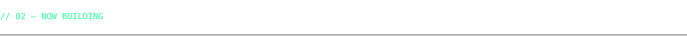
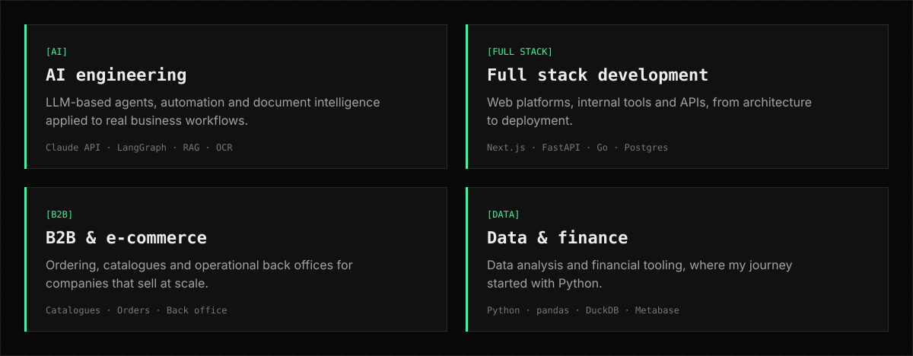
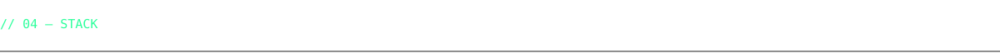
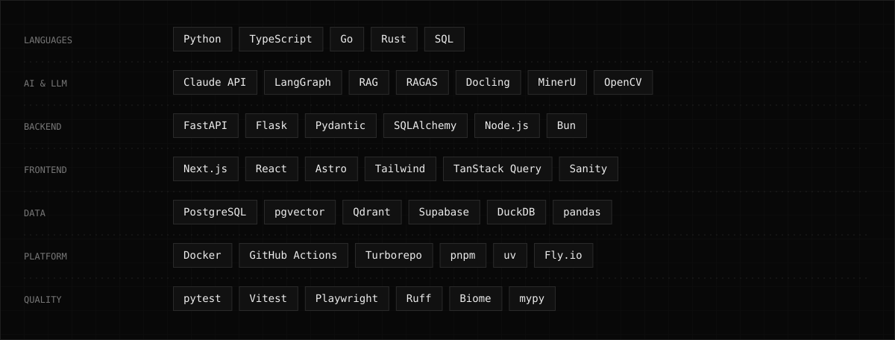
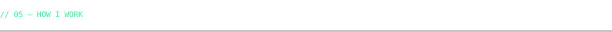
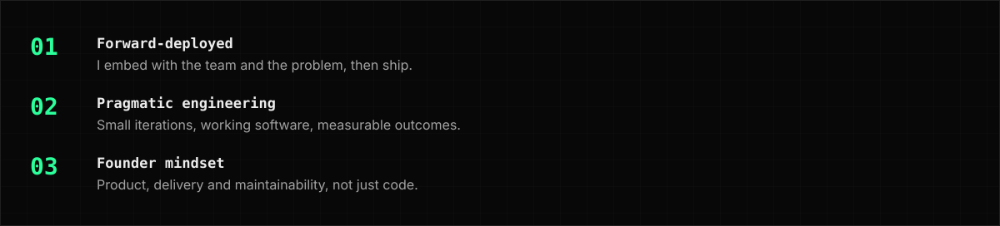
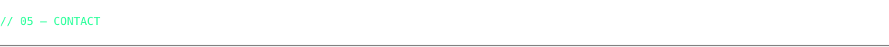
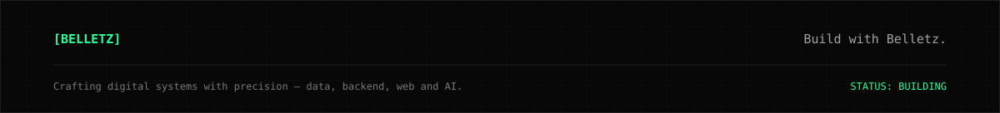

<p align="center">
  
</p>

<p align="center">
  <a href="https://github.com/CBM-Solutions"></a>
  <a href="mailto:0XDev28@protonmail.com"></a>
  
</p>

<br/>


**Full Stack & Forward Deployed AI Engineer · Founder of [CBM-Solutions](https://github.com/CBM-Solutions).**
6+ years building software end to end: from data and backend to production web applications and AI-powered systems. I work close to the customer's problem and take solutions from idea to production.

<br/>




<sub>Most of my work lives in private repositories: happy to walk through any of these on a call.</sub>

<br/>




<br/>





<br/>





<br/>



```console
~/belletz $ ./contact --list
  company   →  github.com/CBM-Solutions
  mail      →  0XDev28@protonmail.com
  web       →  buildwithbelletz (coming soon)
```


