<p align="center">
  <picture>
    <source media="(prefers-color-scheme: dark)" srcset="assets/banner-dark.svg"/>
    
  </picture>
</p>

<p align="center">
  <a href="https://github.com/CBM-Solutions"></a>
  <a href="mailto:0XDev28@protonmail.com"></a>
</p>

## `TAV. 01` About

<table><tr><td>
<code>[ABOUT]</code> &nbsp;<sub>🟡 AVAILABLE FOR PROJECTS</sub>
<h3>Full Stack &amp; Forward Deployed AI Engineer</h3>
Founder of <a href="https://github.com/CBM-Solutions">CBM-Solutions</a>. 6+ years building software end to end: from data and backend to production web applications and AI-powered systems. I work close to the customer's problem and take solutions from idea to production.<br/><br/>
<code>FULL&nbsp;STACK</code> <code>FORWARD&nbsp;DEPLOYED&nbsp;AI</code> <code>FOUNDER</code>
</td></tr></table>

## `TAV. 02` Now building

<sub>Most of my work lives in private repositories: happy to walk through any of these on a call.</sub>

<table><tr><td>
<code>[DEV TOOLING]</code> &nbsp;<sub>🟡 PRIVATE · IN PROGRESS</sub>
<h3>belletz-skills</h3>
Claude Code plugin marketplace for engineering-grade delivery: risk-scaled SDLC protocol, independent review, CI-parity gates, context and cost guards, benchmarks on frozen real tasks.<br/><br/>
<code>Python</code> <code>Claude&nbsp;Code</code> <code>Hooks</code> <code>SQLite</code>
</td></tr></table>

<table><tr><td>
<code>[MARKET INTELLIGENCE]</code> &nbsp;<sub>🟡 PRIVATE · IN PROGRESS</sub>
<h3>Semiconductor Intelligence</h3>
Upstream supply-chain signals (FRED, SEC EDGAR, equities, tech news) turned into a 0–100 scarcity index and a TCO engine that forecast compute availability and pricing.<br/><br/>
<code>Python&nbsp;3.14</code> <code>PostgreSQL&nbsp;18</code> <code>FastAPI</code> <code>uv</code>
</td></tr></table>

<table><tr><td>
<code>[AI · RAG]</code> &nbsp;<sub>🟡 PRIVATE · IN PROGRESS</sub>
<h3>Konny</h3>
Multi-agent RAG assistant over WhatsApp, email and documents for the fashion-accessories supply chain: 9-stage hybrid retrieval, reranking and corrective grading.<br/><br/>
<code>Claude</code> <code>Qdrant</code> <code>FastAPI</code> <code>SvelteKit</code>
</td></tr></table>

<table><tr><td>
<code>[TRADING LAB]</code> &nbsp;<sub>🟡 PRIVATE · IN PROGRESS</sub>
<h3>Quantum</h3>
Automated trading lab: market replay, risk controls and demo execution, with append-only run authority and every claim backed by test evidence.<br/><br/>
<code>Python&nbsp;3.14</code> <code>NautilusTrader</code> <code>Postgres</code> <code>Docker</code>
</td></tr></table>

<table><tr><td>
<code>[GROWTH]</code> &nbsp;<sub>🟡 PRIVATE · IN PROGRESS</sub>
<h3>B2Search</h3>
Lead generation and technical audit engine: DNS, security, SEO and AI-readiness checks turned into scored opportunities and personalised, approval-gated outreach.<br/><br/>
<code>Python</code> <code>asyncio</code> <code>Claude</code> <code>Streamlit</code>
</td></tr></table>

<table><tr><td>
<code>[PLATFORM]</code> &nbsp;<sub>🟡 PRIVATE · IN PROGRESS</sub>
<h3>UniPost</h3>
Open platform where Italian university students share questions, answers and original study material, with reputation levels and multi-stage moderation.<br/><br/>
<code>Next.js</code> <code>Supabase</code> <code>pgvector</code> <code>Playwright</code>
</td></tr></table>

## `TAV. 03` What I do

<table>
<tr>
<td width="50%" valign="top">
<code>[AI]</code>
<h3>🤖 AI engineering</h3>
LLM-based agents, automation and document intelligence applied to real business workflows.
</td>
<td width="50%" valign="top">
<code>[FULL STACK]</code>
<h3>🧩 Full stack</h3>
Web platforms, internal tools and APIs, from architecture to deployment.
</td>
</tr>
<tr>
<td width="50%" valign="top">
<code>[B2B]</code>
<h3>🛒 B2B &amp; e-commerce</h3>
Ordering, catalogues and operational back offices.
</td>
<td width="50%" valign="top">
<code>[DATA]</code>
<h3>📊 Data &amp; finance</h3>
Data analysis and financial tooling, where my journey started with Python.
</td>
</tr>
</table>

## `TAV. 04` Stack

<table>
<tr><td><b>LANGUAGES</b></td><td><code>Python</code> <code>TypeScript</code> <code>Go</code> <code>Rust</code> <code>SQL</code></td></tr>
<tr><td><b>AI &AMP; LLM</b></td><td><code>Claude&nbsp;API</code> <code>LangGraph</code> <code>RAG</code> <code>RAGAS</code> <code>Docling</code> <code>MinerU</code> <code>OpenCV</code></td></tr>
<tr><td><b>BACKEND</b></td><td><code>FastAPI</code> <code>Flask</code> <code>Pydantic</code> <code>SQLAlchemy</code> <code>Node.js</code> <code>Bun</code></td></tr>
<tr><td><b>FRONTEND</b></td><td><code>Next.js</code> <code>React</code> <code>Astro</code> <code>Tailwind</code> <code>TanStack&nbsp;Query</code> <code>Sanity</code></td></tr>
<tr><td><b>DATA</b></td><td><code>PostgreSQL</code> <code>pgvector</code> <code>Qdrant</code> <code>Supabase</code> <code>DuckDB</code> <code>pandas</code></td></tr>
<tr><td><b>PLATFORM</b></td><td><code>Docker</code> <code>GitHub&nbsp;Actions</code> <code>Turborepo</code> <code>pnpm</code> <code>uv</code> <code>Fly.io</code></td></tr>
<tr><td><b>QUALITY</b></td><td><code>pytest</code> <code>Vitest</code> <code>Playwright</code> <code>Ruff</code> <code>Biome</code> <code>mypy</code></td></tr>
</table>

## `TAV. 05` How I work

<table>
<tr><td><h3><code>01</code></h3></td><td><b>Forward-deployed</b><br/>I embed with the team and the problem, then ship.</td></tr>
<tr><td><h3><code>02</code></h3></td><td><b>Pragmatic engineering</b><br/>Small iterations, working software, measurable outcomes.</td></tr>
<tr><td><h3><code>03</code></h3></td><td><b>Founder mindset</b><br/>Product, delivery and maintainability, not just code.</td></tr>
</table>

## `TAV. 06` Contact

```console
~/belletz $ ./contact --list
company  →  github.com/CBM-Solutions
mail     →  0XDev28@protonmail.com
web      →  buildwithbelletz (coming soon)
```

<p align="center"><sub><code>SCALE 1:1</code> &nbsp;·&nbsp; <b>Build with Belletz.</b> &nbsp;·&nbsp; <code>TAV. 06 / 06</code></sub></p>
